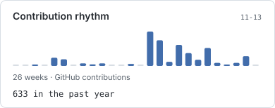
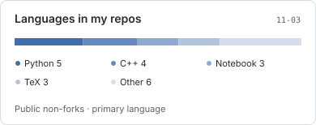

## `>` Yuchen (Ean) Wang

Agentic post-training & ML systems · M.S. CS [@illinois](https://github.com/illinois) · Research intern [@Accio-Lab](https://github.com/Accio-Lab) / [@alibaba](https://github.com/alibaba).

### [Occamy-1.0](https://accio-lab.github.io/occamy/)

35B-A3B agent model for long-horizon tool use. **Core contributor** — post-training algorithms, infrastructure & data. 
<a href="https://huggingface.co/collections/Accio-Lab/occamy-10" title="1,190,764 all-time downloads across 12 official quantized repositories"><strong>≈1.2M cumulative downloads</strong></a> across official quantized releases.

[Report](https://arxiv.org/abs/2609.11977) · [Demo](https://accio-lab.github.io/occamy/) · [Model](https://huggingface.co/Accio-Lab/Occamy-1.0) · [Code](https://github.com/Accio-Lab/occamy)

### Selected contributions

<!-- PR-PREVIEWS:START -->

<ul>
<li><a href="https://github.com/vllm-project/vllm/pull/54699"><strong>vLLM #54699</strong></a> <code>merged</code> — Remove full-weight copies during MoE loading; conversion peak 7.88 → 3.94 GiB in the exact-shape TP2 benchmark</li>
<li><a href="https://github.com/modelscope/mcore-bridge/pull/211"><strong>mcore-bridge #211</strong></a> <code>merged</code> — Score packed QSA within each document; 2.70× faster in an 8K synthetic selector benchmark</li>
<li><a href="https://github.com/huggingface/datasets/pull/8670"><strong>HF Datasets #8670</strong></a> <code>merged</code> — Preserve source shards during streaming shuffle so four workers can share 19 shards</li>
</ul>

Full PR list · <strong>13 merged</strong> · <strong>1 adopted solution</strong> · <strong>23 open</strong> · 16 projects

<table>
<tr>
<td width="28%" valign="top"><a href="https://github.com/huggingface/datasets"><strong>HF Datasets</strong></a> <code>huggingface</code></td>
<td width="72%">
<a href="https://github.com/huggingface/datasets/pull/8670"><picture><source media="(prefers-color-scheme: dark)" srcset="./assets/prs/status/huggingface-datasets-8670-dark.svg"></picture></a> Preserve source shards during streaming shuffle so four workers can share 19 shards
</td>
</tr>
<tr>
<td width="28%" valign="top"><a href="https://github.com/modelscope/mcore-bridge"><strong>mcore-bridge</strong></a> <code>modelscope</code></td>
<td width="72%">
<a href="https://github.com/modelscope/mcore-bridge/pull/211"><picture><source media="(prefers-color-scheme: dark)" srcset="./assets/prs/status/modelscope-mcore-bridge-211-dark.svg"></picture></a> Score packed QSA within each document; 2.70× faster in an 8K synthetic selector benchmark

<a href="https://github.com/modelscope/mcore-bridge/pull/212"><picture><source media="(prefers-color-scheme: dark)" srcset="./assets/prs/status/modelscope-mcore-bridge-212-dark.svg"></picture></a> Preserve low-precision rounding in gated residual mixing

<a href="https://github.com/modelscope/mcore-bridge/pull/213"><picture><source media="(prefers-color-scheme: dark)" srcset="./assets/prs/status/modelscope-mcore-bridge-213-dark.svg"></picture></a> Bound PLE backward&#x27;s extra workspace through chunked token reductions
</td>
</tr>
<tr>
<td width="28%" valign="top"><a href="https://github.com/NVIDIA-NeMo/Megatron-Bridge"><strong>Megatron Bridge</strong></a> <code>NVIDIA-NeMo</code></td>
<td width="72%">
<a href="https://github.com/NVIDIA-NeMo/Megatron-Bridge/pull/6315"><picture><source media="(prefers-color-scheme: dark)" srcset="./assets/prs/status/NVIDIA-NeMo-Megatron-Bridge-6315-dark.svg"></picture></a> Add Bridge-local Qwen4-Exp text-decoder support; GPU integration is pending

<a href="https://github.com/NVIDIA-NeMo/Megatron-Bridge/pull/6312"><picture><source media="(prefers-color-scheme: dark)" srcset="./assets/prs/status/NVIDIA-NeMo-Megatron-Bridge-6312-dark.svg"></picture></a> Make HF/Megatron comparison failures return a nonzero exit status
</td>
</tr>
<tr>
<td width="28%" valign="top"><a href="https://github.com/THUDM/slime"><strong>slime</strong></a> <code>THUDM</code></td>
<td width="72%">
<a href="https://github.com/THUDM/slime/pull/2412"><picture><source media="(prefers-color-scheme: dark)" srcset="./assets/prs/status/THUDM-slime-2412-dark.svg"></picture></a> Score fan-out rollout samples as a flat group
</td>
</tr>
<tr>
<td width="28%" valign="top"><a href="https://github.com/modelscope/ms-swift"><strong>ms-swift</strong></a> <code>modelscope</code></td>
<td width="72%">
<a href="https://github.com/modelscope/ms-swift/pull/9598"><picture><source media="(prefers-color-scheme: dark)" srcset="./assets/prs/status/modelscope-ms-swift-9598-dark.svg"></picture></a> Add order-preserving packing

<a href="https://github.com/modelscope/ms-swift/pull/9602"><picture><source media="(prefers-color-scheme: dark)" srcset="./assets/prs/status/modelscope-ms-swift-9602-dark.svg"></picture></a> Warm up NCCL before training

<a href="https://github.com/modelscope/ms-swift/pull/9599"><picture><source media="(prefers-color-scheme: dark)" srcset="./assets/prs/status/modelscope-ms-swift-9599-dark.svg"></picture></a> Pass through Muon Nesterov settings

<a href="https://github.com/modelscope/ms-swift/pull/9591"><picture><source media="(prefers-color-scheme: dark)" srcset="./assets/prs/status/modelscope-ms-swift-9591-dark.svg"></picture></a> Expose Muon coefficient selection
</td>
</tr>
<tr>
<td width="28%" valign="top"><a href="https://github.com/flashinfer-ai/flashinfer"><strong>FlashInfer</strong></a> <code>flashinfer-ai</code></td>
<td width="72%">
<a href="https://github.com/flashinfer-ai/flashinfer/pull/4984"><picture><source media="(prefers-color-scheme: dark)" srcset="./assets/prs/status/flashinfer-ai-flashinfer-4984-dark.svg"></picture></a> Restore K/V calibration in FP8 KV prefill, correcting silently mis-scaled attention outputs
</td>
</tr>
<tr>
<td width="28%" valign="top"><a href="https://github.com/vllm-project/vime"><strong>vime</strong></a> <code>vllm-project</code></td>
<td width="72%">
<a href="https://github.com/vllm-project/vime/pull/337"><picture><source media="(prefers-color-scheme: dark)" srcset="./assets/prs/status/vllm-project-vime-337-dark.svg"></picture></a> Forward recompute flags; fix hybrid models
</td>
</tr>
<tr>
<td width="28%" valign="top"><a href="https://github.com/NVIDIA-NeMo/Emerging-Optimizers"><strong>Emerging Optimizers</strong></a> <code>NVIDIA-NeMo</code></td>
<td width="72%">
<a href="https://github.com/NVIDIA-NeMo/Emerging-Optimizers/pull/230"><picture><source media="(prefers-color-scheme: dark)" srcset="./assets/prs/status/NVIDIA-NeMo-Emerging-Optimizers-230-dark.svg"></picture></a> Keep Muon scale-invariant
</td>
</tr>
<tr>
<td width="28%" valign="top"><a href="https://github.com/NVIDIA-NeMo/Gym"><strong>NeMo Gym</strong></a> <code>NVIDIA-NeMo</code></td>
<td width="72%">
<a href="https://github.com/NVIDIA-NeMo/Gym/pull/2726"><picture><source media="(prefers-color-scheme: dark)" srcset="./assets/prs/status/NVIDIA-NeMo-Gym-2726-dark.svg"></picture></a> Preserve HTTP errors across process boundaries Co-author
</td>
</tr>
<tr>
<td width="28%" valign="top"><a href="https://github.com/Dao-AILab/flash-attention"><strong>FlashAttention</strong></a> <code>Dao-AILab</code></td>
<td width="72%">
<a href="https://github.com/Dao-AILab/flash-attention/pull/2507"><picture><source media="(prefers-color-scheme: dark)" srcset="./assets/prs/status/Dao-AILab-flash-attention-2507-dark.svg"></picture></a> Prevent redundant backward-kernel recompilation with stable cache keys, without CPU–GPU sync <a href="https://github.com/Dao-AILab/flash-attention/pull/2507#issuecomment-4921776396">Solution adopted by the PR author</a>
</td>
</tr>
<tr>
<td width="28%" valign="top"><a href="https://github.com/vllm-project/vllm"><strong>vLLM</strong></a> <code>vllm-project</code></td>
<td width="72%">
<a href="https://github.com/vllm-project/vllm/pull/58219"><picture><source media="(prefers-color-scheme: dark)" srcset="./assets/prs/status/vllm-project-vllm-58219-dark.svg"></picture></a> Clarify Qwen3 parser boundary tokens in custom grammars

<a href="https://github.com/vllm-project/vllm/pull/54699"><picture><source media="(prefers-color-scheme: dark)" srcset="./assets/prs/status/vllm-project-vllm-54699-dark.svg"></picture></a> Remove full-weight copies during MoE loading; conversion peak 7.88 → 3.94 GiB in the exact-shape TP2 benchmark
</td>
</tr>
<tr>
<td width="28%" valign="top"><a href="https://github.com/NVIDIA/Megatron-LM"><strong>Megatron-LM</strong></a> <code>NVIDIA</code></td>
<td width="72%">
<a href="https://github.com/NVIDIA/Megatron-LM/pull/7864"><picture><source media="(prefers-color-scheme: dark)" srcset="./assets/prs/status/NVIDIA-Megatron-LM-7864-dark.svg"></picture></a> Preserve native Adam step counters across checkpoint restoration

<a href="https://github.com/NVIDIA/Megatron-LM/pull/7881"><picture><source media="(prefers-color-scheme: dark)" srcset="./assets/prs/status/NVIDIA-Megatron-LM-7881-dark.svg"></picture></a> Reuse packed chunkwise CP metadata across GDN and KDA layers

<a href="https://github.com/NVIDIA/Megatron-LM/pull/5396"><picture><source media="(prefers-color-scheme: dark)" srcset="./assets/prs/status/NVIDIA-Megatron-LM-5396-dark.svg"></picture></a> Fuse GDN Q/K normalization to remove an extra backward activation buffer

<a href="https://github.com/NVIDIA/Megatron-LM/pull/5463"><picture><source media="(prefers-color-scheme: dark)" srcset="./assets/prs/status/NVIDIA-Megatron-LM-5463-dark.svg"></picture></a> Enable selective Mamba mixer recompute to save activation memory without full-layer recomputation

<a href="https://github.com/NVIDIA/Megatron-LM/pull/5400"><picture><source media="(prefers-color-scheme: dark)" srcset="./assets/prs/status/NVIDIA-Megatron-LM-5400-dark.svg"></picture></a> Route GDN input projections to Adam

<a href="https://github.com/NVIDIA/Megatron-LM/pull/5431"><picture><source media="(prefers-color-scheme: dark)" srcset="./assets/prs/status/NVIDIA-Megatron-LM-5431-dark.svg"></picture></a> Exclude GDN input projections from global clipping

<a href="https://github.com/NVIDIA/Megatron-LM/pull/5395"><picture><source media="(prefers-color-scheme: dark)" srcset="./assets/prs/status/NVIDIA-Megatron-LM-5395-dark.svg"></picture></a> Skip gradient clipping for Muon
</td>
</tr>
<tr>
<td width="28%" valign="top"><a href="https://github.com/NVIDIA-NeMo/RL"><strong>NeMo RL</strong></a> <code>NVIDIA-NeMo</code></td>
<td width="72%">
<a href="https://github.com/NVIDIA-NeMo/RL/pull/4193"><picture><source media="(prefers-color-scheme: dark)" srcset="./assets/prs/status/NVIDIA-NeMo-RL-4193-dark.svg"></picture></a> Render evaluation prompts as complete conversations

<a href="https://github.com/NVIDIA-NeMo/RL/pull/4176"><picture><source media="(prefers-color-scheme: dark)" srcset="./assets/prs/status/NVIDIA-NeMo-RL-4176-dark.svg"></picture></a> Unify worker selection through configuration

<a href="https://github.com/NVIDIA-NeMo/RL/pull/3943"><picture><source media="(prefers-color-scheme: dark)" srcset="./assets/prs/status/NVIDIA-NeMo-RL-3943-dark.svg"></picture></a> Bypass driver tensor materialization in distillation; 4.4–5.3× faster transfers in a controlled Ray benchmark

<a href="https://github.com/NVIDIA-NeMo/RL/pull/2962"><picture><source media="(prefers-color-scheme: dark)" srcset="./assets/prs/status/NVIDIA-NeMo-RL-2962-dark.svg"></picture></a> Sanitize non-finite async log probabilities
</td>
</tr>
<tr>
<td width="28%" valign="top"><a href="https://github.com/sgl-project/sglang"><strong>SGLang</strong></a> <code>sgl-project</code></td>
<td width="72%">
<a href="https://github.com/sgl-project/sglang/pull/40103"><picture><source media="(prefers-color-scheme: dark)" srcset="./assets/prs/status/sgl-project-sglang-40103-dark.svg"></picture></a> Reject developer messages silently dropped by templates

<a href="https://github.com/sgl-project/sglang/pull/39765"><picture><source media="(prefers-color-scheme: dark)" srcset="./assets/prs/status/sgl-project-sglang-39765-dark.svg"></picture></a> Publish Mamba cache updates before dependent batches capture stale KV mappings

<a href="https://github.com/sgl-project/sglang/pull/38063"><picture><source media="(prefers-color-scheme: dark)" srcset="./assets/prs/status/sgl-project-sglang-38063-dark.svg"></picture></a> Explain cold MXFP4 JIT startup

<a href="https://github.com/sgl-project/sglang/pull/31621"><picture><source media="(prefers-color-scheme: dark)" srcset="./assets/prs/status/sgl-project-sglang-31621-dark.svg"></picture></a> Honor weight-check exclusions during reset
</td>
</tr>
<tr>
<td width="28%" valign="top"><a href="https://github.com/verl-project/verl"><strong>verl</strong></a> <code>verl-project</code></td>
<td width="72%">
<a href="https://github.com/verl-project/verl/pull/7906"><picture><source media="(prefers-color-scheme: dark)" srcset="./assets/prs/status/verl-project-verl-7906-dark.svg"></picture></a> Track response truncation across context limits

<a href="https://github.com/verl-project/verl/pull/7597"><picture><source media="(prefers-color-scheme: dark)" srcset="./assets/prs/status/verl-project-verl-7597-dark.svg"></picture></a> Validate actor FSDP strategy
</td>
</tr>
<tr>
<td width="28%" valign="top"><a href="https://github.com/NousResearch/hermes-agent"><strong>Hermes Agent</strong></a> <code>NousResearch</code></td>
<td width="72%">
<a href="https://github.com/NousResearch/hermes-agent/pull/113511"><picture><source media="(prefers-color-scheme: dark)" srcset="./assets/prs/status/NousResearch-hermes-agent-113511-dark.svg"></picture></a> Control partial-stream continuation for batch evaluation

<a href="https://github.com/NousResearch/hermes-agent/pull/113538"><picture><source media="(prefers-color-scheme: dark)" srcset="./assets/prs/status/NousResearch-hermes-agent-113538-dark.svg"></picture></a> Clarify API retry budgets and streaming defaults
</td>
</tr>
</table>

[All authored PRs](https://github.com/search?q=author%3Ayuchenwang3+is%3Apr&type=pullrequests) · [Engineering notes](https://yuchenwang3.github.io/projects/open-source-systems/)

<!-- PR-PREVIEWS:END -->

### Other research

- **CineFlow** — Dependency-driven parallel video generation. Co-first author · 1.7–5.5× end-to-end speedup in the reported evaluation.
- **[Dynamic Prefill](https://yuchenwang3.github.io/projects/prepack/)** — Adaptive batching and prompt packing; up to 20% lower TTFT on the reported traces. [Report](https://yuchenwang3.github.io/assets/pdf/projects/dynamic-prefill-online-packing-report.pdf) · [Code](https://github.com/Winlere/prepack-workspace)
- **[RareDx](https://arxiv.org/abs/2609.35549)** — Graph-grounded RL for rare disease diagnosis. Co-first author.
- [CUDA Attention](https://yuchenwang3.github.io/assets/pdf/projects/gpt2-processing-unit-report.pdf) · [RL for Legal Reasoning](https://yuchenwang3.github.io/assets/pdf/projects/legal-reasoning-thesis.pdf)

Reviewer, [WSDM 2027](https://www.wsdm-conference.org/2027/).

Activity

<a href="https://github.com/yuchenwang3?tab=overview"><picture>
<source media="(prefers-color-scheme: dark)" srcset="./assets/widgets/activity-dark.svg">

</picture></a>
<a href="https://github.com/yuchenwang3?tab=repositories"><picture>
<source media="(prefers-color-scheme: dark)" srcset="./assets/widgets/languages-dark.svg">

</picture></a>

#### Contribution trail

<picture>
<source media="(prefers-color-scheme: dark)" srcset="https://raw.githubusercontent.com/yuchenwang3/yuchenwang3/output/github-snake-dark.svg">

</picture>

